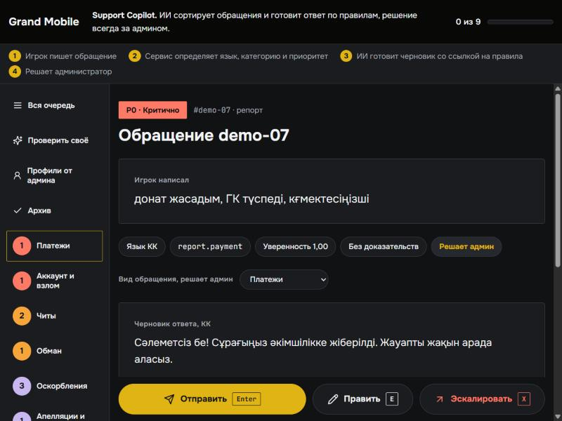
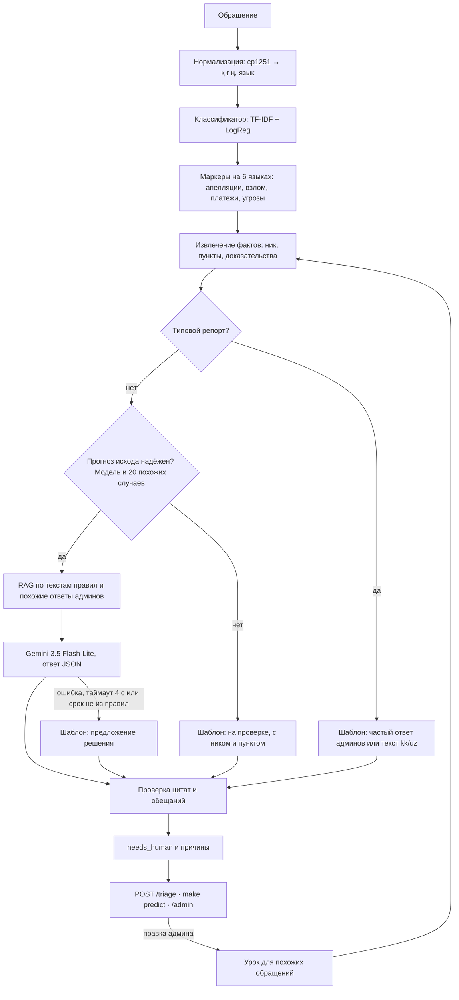

# Support Copilot

**Ассистент поддержки Grand Mobile: сортирует обращения игроков, пишет черновик ответа на языке игрока со ссылками на пункты правил и честно говорит, когда нужен человек.**

Решение кейса 03 Grand Mobile на Decentrathon 6.0.



*Интерфейс админа на придуманных обращениях. Главный продукт — сервис `POST /triage`, интерфейс показывает, как с ним работать. Входа для админов нет: это демо для локального запуска, поэтому по умолчанию сервис слушает только `127.0.0.1`.*

## Где что

| Хочу | Куда |
|---|---|
| Запустить за 3 команды | [Как запустить](#как-запустить) |
| Проверить контракт из ТЗ | `POST /triage` и `make predict`, там же |
| Увидеть метрики и честные оговорки | [docs/REPORT.md](docs/REPORT.md) |
| Посмотреть все функции на примерах | [docs/examples.md](docs/examples.md), страница [docs/examples.html](docs/examples.html) |
| Понять устройство | [Как это устроено](#как-это-устроено) |
| Открыть интерфейс админа | `make serve`, затем `/admin` |

## Результаты

Все цифры воспроизводятся командами `make eval` и `make audit`. Без ключа LLM работает всё, кроме генерации текста моделью.

| Критерий ТЗ | Результат | Лимит |
|---|---|---|
| Классификация | категория **80,0%**, macro-F1 приоритета **0,713** на ручной разметке 150 обращений | — |
| Без галлюцинаций | **0 из 712** цитат вне правил, цитата везде, где она нужна, **82,7%** совпадений с пунктом админа | выдуманный пункт обнуляет тикет |
| Защита | **26 из 26** проверок на 6 языках: взлом, платёж, апелляция и угроза идут человеку и получают P0 | всегда человеку |
| Черновики | предложение решения у **49%** жалоб с точностью **85%**, у остальных ответ по существу, отписок **0** | оценку дадут админы |
| Казахский и узбекский | **100%** черновиков на языке игрока, новые шаблоны носителем не проверены | — |
| Стоимость | **$0,00019** за обращение с Gemini, $0 без ключа | $0,002 |
| Латентность | **p95 = 1,89 с** с Gemini, 0,014 с без ключа | 5 с |

Подробно и с оговорками: [docs/REPORT.md](docs/REPORT.md). Примеры ответов: [docs/examples.md](docs/examples.md).

## Проблема

Админы вручную разбирают из игры десятки тысяч обращений на 6 языках. Большая часть ответов однотипна, а взломы, платежи и читы тонут среди «помогите» и «+».

## Решение

Сервис получает обращение и за секунду возвращает язык, категорию, приоритет, извлечённые факты, черновик с цитатами правил и честную оценку: можно ответить автоматически или нужен человек.

**В чём сила:**

- **Опирается на 85 тыс. решённых случаев.** Сервис видит, чем заканчивались похожие жалобы, и предлагает решение там, где точность проверена: 85% на валидации.
- **Предлагает, а не решает.** Жалоба с вложениями всегда идёт человеку: вложений сервис не видит. Прогноз помечен как прогноз, срок цитируется дословно из пункта правил, отправка требует второго нажатия.
- **Не выдумывает.** Каждая цитата сверяется кодом с `rules.json`. В контракте цитата это `points[].ref` (`2.1`), в тексте с разделом (`2.1 ОП`), потому что голый «1.1» есть в 10 разделах.
- **Не обещает лишнего.** Разбан и возврат денег сервис не предлагает никогда, такие черновики заменяются нейтральной передачей администрации.
- **Защищает на всех языках.** Взлом на казахском важен так же, как на русском. Провокации лежат отдельно от кода защиты: тест не проверяет регулярку саму собой.
- **Использует LLM там, где он полезен.** Мы сравнили Gemini и шаблоны на одних и тех же обращениях: без прогноза модель называла решения, которых никто не принимал, поэтому «на проверке» и апелляции пишет шаблон. Срок проверяется по тексту пункта.
- **Работает без ключа.** Без LLM жалоба всё равно получает ответ по существу.
- **Учится на правках.** Исправленный ответ сразу меняет следующий похожий черновик.
- **Честен о своих ошибках.** Автоматическая разметка показывала 83%, ручная 57%, сейчас 80%. Вся история и то, что мы не проверили, в [отчёте](docs/REPORT.md).

## Как запустить

Нужен Python 3.11+ и папка с данными кейса (`handout`): данные Grand Mobile по условиям кейса в репозитории не лежат.

```bash
git clone https://github.com/Suesh10/grand-support-copilot.git
cd grand-support-copilot
make install
make predict DATA=/путь/к/handout IN=/путь/к/handout/tickets_valid.jsonl OUT=pred.jsonl
```

При первом запуске модели обучатся автоматически из `tickets_train.jsonl.gz` (около 6 минут). Команда из ТЗ `make predict IN=tickets.jsonl OUT=pred.jsonl` работает так же, если данные лежат в `data/support/handout`. Сбой на отдельной строке не останавливает прогон: такая строка получает ответ по контракту с передачей человеку.

Сервис и интерфейс админа:

```bash
make serve DATA=/путь/к/handout
```

- `POST http://localhost:8000/triage` — контракт из ТЗ
- `http://localhost:8000/admin` — очередь админа: 32 придуманных примера из `examples/sample_tickets.jsonl`, у каждого написано, какую функцию он показывает
- `http://localhost:8000/docs` — интерактивная документация API
- `http://localhost:8000/health` — состояние моделей и LLM

```bash
curl -X POST localhost:8000/triage -H "Content-Type: application/json" -d '{"kind":"complaint","messages":[{"role":"player","text":"Arman_Petrov оскорблял меня и мою семью в чате, скрины есть, 2.1 ОП","attachments":2}]}'
```

Для доступа из закрытой сети: `make serve HOST=0.0.0.0`. Входа в интерфейс нет, поэтому в открытую сеть его выставлять нельзя.

### Запуск в один шаг

На Windows дважды щёлкните `start.bat`. На macOS и Linux выполните `sh start.sh`. Работает и `python run.py`, нужен только Python 3.10 или новее.

Скрипт сам ставит зависимости, находит данные в папке `data/`, обучает модели, выбирает свободный порт, открывает браузер и перезапускает сервис, если тот упал. Без данных запускается демо, а вкладка «Справка» показывает, чего не хватает и что сделать. Самопроверка без запуска: `python run.py --check`.

### С LLM и без него

**Без ключа всё работает** офлайн. Для черновиков через Gemini скопируйте `.env.example` в `.env` и впишите `GEMINI_API_KEY`. Если LLM не ответил за 4 с, сервис сам уходит в офлайн, а интерфейс показывает, что ИИ недоступен. На бесплатном ключе есть дневной лимит: для потока нужен платный тариф.

### Другие команды

| Команда | Что делает |
|---|---|
| `make train` | обучает модели, строит индекс похожих случаев и предложения шаблонов |
| `make eval` | считает отчёт на валидации: метрики, стоимость, p95 |
| `make doctor` | самопроверка простым языком: что работает и что сделать |
| `make examples` | пересобирает `docs/examples.md` и `docs/examples.html` |
| `python scripts/articles.py` | обновляет список статей поддержки, нужен интернет |
| `make audit` | построчная проверка ответов по ТЗ и провокации на 6 языках; `AUDIT_LLM=100` пропустит 100 обращений через LLM |
| `make review` | готовит слепую оценку: черновики рядом с реальными ответами, вкладка в интерфейсе |
| `make test DATA=/путь/к/handout` | запускает тесты, без данных они пропускаются |

## Как это устроено



**Классификация без LLM** стоит ноль и занимает миллисекунды, поэтому LLM вызывается только для черновика. Символьные n-граммы устойчивы к опечаткам, транслиту и смеси языков.

**Разметки в данных нет.** Категории восстановлены по исходам из ответов админов («2.1 ОП» → оскорбление), точность проверена на ручной разметке. У 35% жалоб исход не был распознан при выгрузке: половина восстановлена из текста ответа.

### Стек

Python, FastAPI, scikit-learn, Gemini 3.5 Flash-Lite (`google-genai`).

Сторонние модели и данные: открытые статьи центра поддержки support.grnd.gg (только названия, ссылки и ключевые слова), внешний LLM Gemini 3.5 Flash-Lite от Google по API, стоимость посчитана в [отчёте](docs/REPORT.md). Классификатор обучен с нуля на данных кейса, предобученные модели и открытые датасеты не использовались.

### Структура

```text
copilot/
  api.py        HTTP-сервис: POST /triage
  pipeline.py   весь путь обращения
  normalize.py  cp1251, язык, смешанные алфавиты
  rules.py      пункты правил, канонические id, проверка цитат
  classify.py   категория и приоритет
  signals.py    опасные темы на всех языках игры
  labels.py     автоматическая разметка, исходы из ответов админов
  extract.py    извлечение фактов и их места в тексте
  rag.py        поиск по текстам правил
  retrieve.py   поиск похожих случаев и как их решали
  dedupe.py     отсев дублей
  llm.py        промпт, вызов Gemini, кэш для админки, статус
  draft.py      предложение решения и офлайн-черновики
  templates.py  тексты на ru/kk/uz/en/es/pt
  guard.py      needs_human, запрет обещаний, prompt injection
  learn.py      учёба на правках админа
  clusters.py   предложение новых шаблонов
  reputation.py профиль игрока из истории обращений
  admin.py      API интерфейса админа
  static/       страница /admin
scripts/        обучение, отчёт, аудит, примеры
tests/          контракт, провокации, интерфейс
examples/       придуманные обращения и провокации
docs/           отчёт и примеры
```

## Бонусы из ТЗ

- **Интерфейс админа:** очередь, черновик, «отправить / править / эскалировать», генерация ответа под выбранный исход. Факты подсвечены прямо в тексте игрока, рядом видно, как решали похожие жалобы. Панель смены считает живые цифры: сколько принято без правок, медиану рассмотрения, очередь.
- **Правки как обучающий сигнал:** исправленный ответ сразу становится образцом для похожих обращений, правка проходит те же проверки.
- **Дедупликация:** похожие обращения одного игрока за час считаются одной проблемой, это 7,4% репортов. Серии жалоб на одного игрока объединяются в очереди одной кнопкой.
- **Шаблоны по кластерам:** сервис группирует обращения и предлагает новый шаблон там, где админы отвечают одинаково. Принятый шаблон проходит те же проверки.
- **Сверх ТЗ:** слепая оценка 1–5 рядом с реальным ответом, как у жюри; профиль игрока при наведении; апелляции отдельной вкладкой; архив со временем рассмотрения. Через 30 дней сайт предлагает удалить обращение, но сам ничего не удаляет.

## Что не проверено

- Живые админы черновики не оценивали.
- Носители не проверяли новые шаблоны на kk и uz.
- Просмотр доказательств показан на демо-картинке: файлов в данных нет, только их количество.
- Точность прогноза подобрана и измерена на одной валидации, поэтому она оптимистична.

## Что дальше

- Настоящие оценки админов вместо прокси-сходства.
- Передача вложений в контракт: модель сможет читать скриншоты.
- Ручная разметка большей выборки вместо автоматических меток.
- Радар инцидентов: всплеск похожих обращений на одном сервере как один инцидент P0. Нужно поле `server` в контракте: в выгрузке есть только регион.
- Интеграция в игру через контракт `POST /triage`.

## Данные

Данные Grand Mobile используются только для кейса и в репозиторий не входят, как и обученные модели с индексом обращений. В отчёте только агрегированные цифры, примеры придуманы.

## Команда

Dilyara Kydyralina, Dulat Kydyralin, Emir Rakhmetolla
