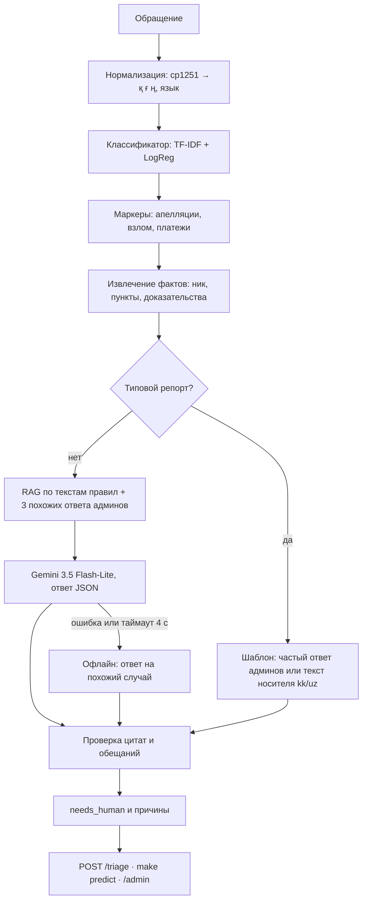

# Support Copilot

**Ассистент поддержки Grand Mobile: сортирует обращения игроков, пишет черновик ответа как опытный админ и никогда не выдумывает правила.**

Решение кейса 03 Grand Mobile на Decentrathon 6.0.


*Интерфейс админа на придуманных обращениях. Главный продукт — сервис `POST /triage`, интерфейс показывает, как с ним работать.*

## Где что

| Хочу | Куда |
|---|---|
| Запустить за 3 команды | [Как запустить](#как-запустить) |
| Проверить контракт из ТЗ | `POST /triage` и `make predict`, там же |
| Увидеть метрики и честные оговорки | [docs/REPORT.md](docs/REPORT.md) |
| Посмотреть примеры ответов | [docs/examples.md](docs/examples.md) |
| Понять устройство | [Как это устроено](#как-это-устроено) |
| Открыть интерфейс админа | `make serve`, затем `/admin` |

## Результаты

| Критерий ТЗ | Результат | Лимит |
|---|---|---|
| Классификация | категория **78%**, macro-F1 приоритета **0,716** (ручная разметка 150 обращений) | — |
| Без галлюцинаций | **0 из 1153** цитат вне `rules.json`, **100%** жалоб с цитатой | выдуманный пункт обнуляет тикет |
| Казахский и узбекский | шаблоны от носителя, **100%** черновиков на языке игрока | — |
| Стоимость | **$0,00044** за обращение | $0,002 |
| Латентность | **p95 = 2,82 с** с LLM, 0,04 с офлайн | 5 с |

Подробно и с оговорками: [docs/REPORT.md](docs/REPORT.md). Примеры ответов: [docs/examples.md](docs/examples.md).

## Проблема

Админы вручную разбирают из игры десятки тысяч обращений на 6 языках. Большая часть ответов однотипна, а взломы, платежи и читы тонут среди «помогите» и «+».

## Решение

Сервис получает обращение и за секунду возвращает язык, категорию, приоритет, извлечённые факты, черновик ответа с цитатами правил и честную оценку: можно ответить автоматически или нужен человек.

**В чём сила:**

- **Пишет как лучший админ.** Опирается на индекс из 73 тыс. реальных ответов администраторов: LLM видит, как отвечали на похожие случаи с тем же вероятным исходом.
- **Не выдумывает правила.** Настоящий RAG по текстам всех пунктов: LLM получает только найденные пункты, каждая цитата сверяется кодом с `rules.json`. В контракте цитата это `points[].ref` (`2.1`), в тексте ответа с разделом (`2.1 ОП`), потому что голый «1.1» есть в 10 разделах.
- **Не обещает лишнего.** Разбан, снятие наказания и возврат денег ловятся кодом на ru/kk/uz, такой черновик заменяется нейтральной передачей старшему админу. Платежи, апелляции и взлом всегда идут человеку.
- **Честно зовёт человека.** Вложений сервис не видит, поэтому не отказывает «мало доказательств», если они приложены. Отсюда высокая доля «нужен человек», 73%: это осознанное решение, объяснённое в отчёте.
- **Работает без ключа.** Если LLM недоступен или не ответил за 4 с, черновик собирается офлайн из похожего случая.
- **Честные метрики.** Автоматическая разметка показывала 83%, ручная — 57%. Разбор ошибок вскрыл, что 30% жалоб это апелляции, и дал итоговые 78%. Сверка с ТЗ вскрыла и другие наши ошибки. Вся история в отчёте.

## Как запустить

Нужен Python 3.11+ и папка с данными кейса (`handout`): данные Grand Mobile по условиям кейса в репозитории не лежат.

```bash
git clone https://github.com/Suesh10/grand-support-copilot.git
cd grand-support-copilot
make install
make predict DATA=/путь/к/handout IN=/путь/к/handout/tickets_valid.jsonl OUT=pred.jsonl
```

При первом запуске модели обучатся автоматически из `tickets_train.jsonl.gz` (около 3 минут). Команда из ТЗ `make predict IN=tickets.jsonl OUT=pred.jsonl` работает так же, если данные лежат в `data/support/handout`.

Сервис и интерфейс админа:

```bash
make serve DATA=/путь/к/handout
```

- `POST http://localhost:8000/triage` — контракт из ТЗ
- `http://localhost:8000/admin` — очередь админа на примерах из `examples/sample_tickets.jsonl`
- `http://localhost:8000/docs` — интерактивная документация API

```bash
curl -X POST localhost:8000/triage -H "Content-Type: application/json" -d '{"kind":"complaint","messages":[{"role":"player","text":"Arman_Petrov оскорблял меня и мою семью в чате, скрины есть, 2.1 ОП","attachments":2}]}'
```

### С LLM и без него

**Без ключа всё работает** в офлайн-режиме. Для черновиков через Gemini скопируйте `.env.example` в `.env` и впишите `GEMINI_API_KEY`. На бесплатном ключе есть лимит запросов в минуту: при его превышении сервис сам уходит в офлайн, для потока нужен платный тариф.

### Другие команды

| Команда | Что делает |
|---|---|
| `make train` | обучает модели и строит индекс похожих случаев |
| `make eval` | считает отчёт на валидации: метрики, стоимость, p95 |
| `make examples` | пересобирает `docs/examples.md` |
| `make test DATA=/путь/к/handout` | запускает тесты, без данных они пропускаются |

## Как это устроено



**Классификация без LLM** стоит ноль и занимает миллисекунды, поэтому LLM вызывается только для черновика. Символьные n-граммы устойчивы к опечаткам, транслиту и смеси языков.

**Разметки в данных нет.** Категории восстановлены по исходам из ответов админов («2.1 ОП» → оскорбление), точность проверена на ручной разметке.

### Стек

Python, FastAPI, scikit-learn, Gemini 3.5 Flash-Lite (`google-genai`).

Сторонние модели и данные: внешний LLM Gemini 3.5 Flash-Lite от Google по API, стоимость посчитана в [отчёте](docs/REPORT.md). Классификатор обучен с нуля на данных кейса, предобученные модели и открытые датасеты не использовались.

### Структура

```text
copilot/
  api.py        HTTP-сервис: POST /triage
  pipeline.py   весь путь обращения
  normalize.py  cp1251, язык, смешанные алфавиты
  rules.py      пункты правил, канонические id, проверка цитат
  classify.py   категория и приоритет
  labels.py     автоматическая разметка, маркеры апелляций
  extract.py    извлечение фактов
  rag.py        поиск по текстам правил
  retrieve.py   поиск похожих случаев
  dedupe.py     отсев дублей
  llm.py        промпт и вызов Gemini
  draft.py      офлайн-черновики
  templates.py  шаблоны kk/uz
  guard.py      needs_human, запрет обещаний, prompt injection
  admin.py      API интерфейса админа
  static/       страница /admin
scripts/        обучение, отчёт, примеры
tests/          контракт, провокации, интерфейс
examples/       придуманные обращения для проверки
docs/           отчёт и примеры
```

## Бонусы из ТЗ

- **Интерфейс админа:** очередь, черновик, генерация ответа под выбранный исход, «отправить / править / эскалировать», правки сохраняются в `artifacts/feedback.jsonl` как обучающий сигнал.
- **Дедупликация:** дубли за час отсеиваются в `make predict` и сервисе, серии жалоб на одного игрока объединяются в очереди одной кнопкой.
- **Шаблоны по кластерам:** частые ответы админов на репорты собираются автоматически.

## Что дальше

- Дообучение на правках админов из `feedback.jsonl`.
- Ручная разметка большей выборки вместо автоматических меток.
- Дедупликация по смыслу, а не только по паре игроков.
- Интеграция в игру через контракт `POST /triage`.

## Данные

Данные Grand Mobile используются только для кейса и в репозиторий не входят, как и обученные модели с индексом обращений. В отчёте только агрегированные цифры, примеры придуманы.

## Команда

Dilyara Kydyralina, Dulat Kydyralin, Emir Rakhmetolla
